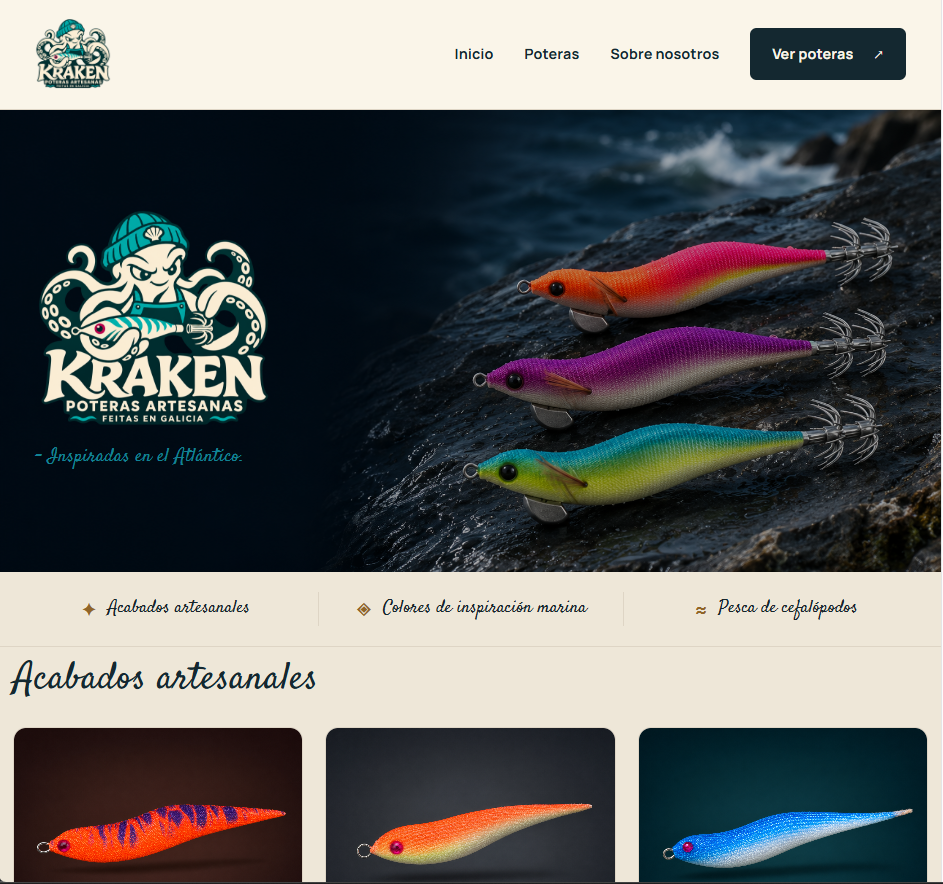

# Tienda online de poteras artesanas

## Vista previa de Kraken

Página principal con cabecera, navegación y productos destacados, desarrollada con React y TypeScript. Proyecto en desarrollo.

Proyecto de una tienda online para mostrar y vender poteras artesanas elaboradas por mí.

El objetivo principal es desarrollar una aplicación completa para mi portfolio, demostrar mis habilidades como desarrollador junior y utilizarla para acceder a mi primera oportunidad profesional en el sector del software. La tienda también podrá ponerse en funcionamiento de forma temporal para realizar ventas reales.

## Estado del proyecto

El proyecto se encuentra en fase de definición y aprendizaje. Las funcionalidades descritas a continuación son objetivos previstos y todavía no están implementadas.

## Objetivos

- Crear una web funcional, moderna y que transmita confianza.
- Ofrecer una navegación clara y un diseño adaptable a móviles, tabletas y ordenadores.
- Desarrollar tanto el frontend como el backend y conectarlos con una base de datos.
- Proteger los datos personales y validar la información recibida por el servidor.
- Mantener el código organizado, con responsabilidades claras y principios de arquitectura limpia y SOLID cuando aporten valor.
- Documentar las decisiones técnicas y aprender a explicar el funcionamiento del proyecto en una entrevista.

## Funcionalidades previstas

- Página de inicio con presentación de la marca y productos destacados.
- Catálogo de poteras con fotografías, precios y disponibilidad.
- Fichas de producto con descripción, materiales, tamaños y colores.
- Carrito y proceso de pedido.
- Integración con un proveedor de pagos, inicialmente en modo de pruebas.
- Confirmación del pago en el backend mediante avisos verificados del proveedor (*webhooks*).
- Envío automático de correos electrónicos de confirmación de pedidos.
- Panel de administración con acceso protegido para gestionar productos, existencias y pedidos.
- Página sobre el proceso artesanal y sección de contacto.

## Tecnologías previstas

La selección definitiva de herramientas y frameworks está pendiente.

| Tecnología | Uso previsto |
| --- | --- |
| HTML y CSS | Estructura, estilos y diseño adaptable |
| JavaScript y TypeScript | Lógica de la aplicación |
| React | Interfaz de usuario |
| Node.js | Backend y conexión con servicios externos |
| SQL y PostgreSQL | Almacenamiento de productos, existencias y pedidos |
| Git | Control de versiones |

## Seguridad y aspectos legales

Antes de activar ventas reales, se revisarán las obligaciones aplicables según el lugar de actividad y los mercados de venta, incluyendo privacidad, cookies, información del vendedor, condiciones de compra, envíos y devoluciones.

Las claves privadas de los servicios externos se mantendrán en el servidor y fuera del repositorio. El tratamiento de los datos de pago se realizará a través del proveedor de pagos elegido.

## Plan de desarrollo

1. Afianzar las bases de HTML, CSS, JavaScript y TypeScript.
2. Crear el diseño y las primeras páginas de productos.
3. Implementar el catálogo y el carrito.
4. Desarrollar el backend y conectar la base de datos.
5. Incorporar la administración de productos y pedidos.
6. Integrar pagos de prueba y correos de confirmación.
7. Verificar los flujos principales, la seguridad básica y la experiencia en móvil.
8. Publicar una versión de demostración y completar la documentación del portfolio.

## Estructura del proyecto

- `frontend/`: interfaz de la tienda con React y TypeScript.
- `backend/`: API y lógica del servidor con Node.js y TypeScript.
- `database/`: migraciones y datos de ejemplo.
- `tests/e2e/`: pruebas de los recorridos completos de la aplicación.
- `docs/`: documentación técnica y decisiones del proyecto.

Cada aplicación tendrá su propia carpeta `src`. Consulta la [explicación de la estructura](docs/structure.md) para conocer la función de cada carpeta.

La base del frontend ya está generada con React, TypeScript, Vite y ESLint. El backend y los servicios externos siguen pendientes de configuración.

## Inicio y aprendizaje

Consulta la [guía de inicio y registro de aprendizaje](docs/getting-started.md) para ejecutar una copia del repositorio, conocer cómo creamos el frontend desde cero y revisar las dudas y decisiones iniciales.

### Mantener actualizada la guía

La guía `docs/getting-started.md` es el registro de aprendizaje y continuidad del proyecto. Debe poder seguirla una persona sin experiencia previa en desarrollo web.

**Instrucción para quienes colaboren en el proyecto, incluidos los asistentes de IA:** leer este README y la guía al retomar el trabajo. Actualizar la guía al completar un paso importante, resolver un problema, tomar una decisión técnica o cerrar una sesión con avances relevantes. No esperar a que se solicite de nuevo.

En cada actualización, registrar:

- Qué queríamos conseguir y por qué.
- Los pasos en orden, los comandos exactos y la carpeta desde la que se ejecutan.
- Los archivos creados o modificados y su función, explicados con lenguaje sencillo.
- Los problemas encontrados, sus causas si se conocen, los intentos relevantes y la solución aplicada.
- Cómo comprobamos el resultado y qué queda sin verificar o pendiente de solucionar.
- El estado actual y el siguiente paso concreto para continuar.

Mantener la fecha de actualización y revisar las indicaciones anteriores para evitar contradicciones. Diferenciar lo previsto, lo implementado y lo comprobado; no presentar una propuesta como una solución aplicada. No registrar contraseñas, claves privadas ni datos personales de clientes.

Este registro sirve como memoria escrita del proyecto para futuras sesiones. Para recuperar el contexto hay que leerlo: no depende de que un asistente conserve el historial de la conversación.

## Pruebas

El frontend tendrá pruebas de funciones y componentes; el backend tendrá pruebas unitarias y de integración. También habrá pruebas de extremo a extremo para verificar el recorrido de compra desde el navegador.

Las carpetas están creadas, pero las pruebas y sus herramientas todavía no están implementadas. Consulta la [estrategia de pruebas](docs/testing.md) para conocer los casos prioritarios y el uso de datos y servicios de prueba.

## Documentación pendiente

A medida que avance el desarrollo, este README incluirá las instrucciones de instalación, la configuración de las variables de entorno, la estructura del proyecto, las pruebas y el enlace a la demostración.
